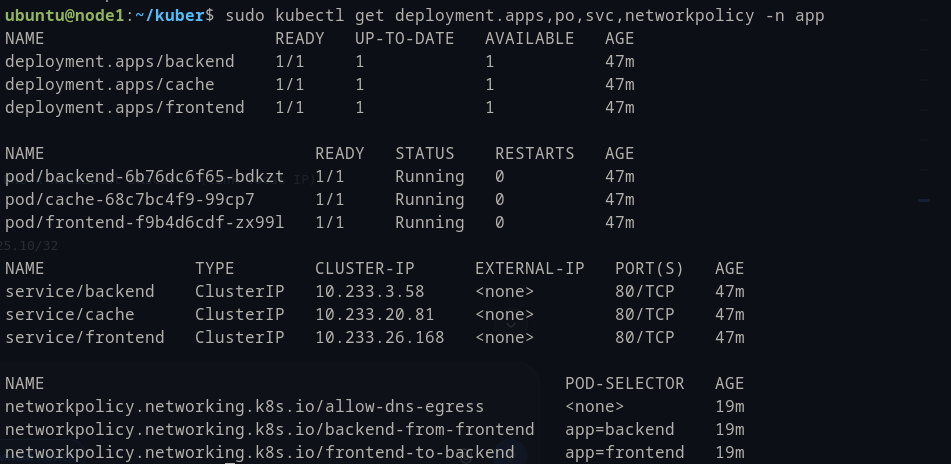
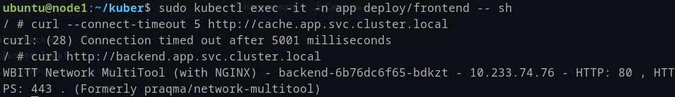
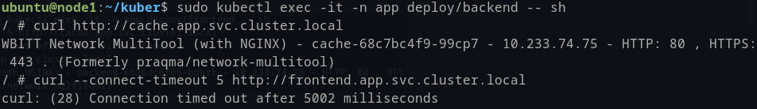
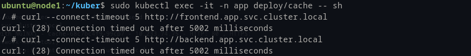

# Домашнее задание к занятию «Как работает сеть в K8s»

Манифесты:

[deployment.yaml](deployment.yaml)

[services.yaml](services.yaml)

[namespace.yaml](namespace.yaml)

[allow-to-dns.yaml](allow-to-dns.yaml)

[backent-to-cache.yaml](backent-to-cache.yaml)

[default-deny.yaml](default-deny.yaml)

[frontend-to-backend.yaml](frontend-to-backend.yaml)

Запущенные манифесты:

## Проверка разрешённого трафика

### Frontend:

### Backend:

### Cache:

